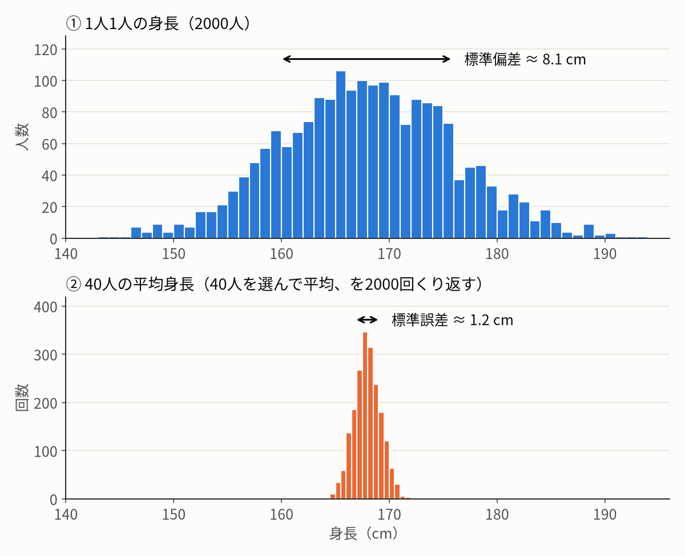

# ゴルフボールを落として「重力の強さ」を測ろう（Excel編）

ゴルフボールを落とす動画を撮り、Tracker で位置を記録し、Excel で「重力加速度 g」を求めます。
さらに、求めた値が **どのくらい信頼できるか** を数字で表す方法を学びます。

数式が苦手でも大丈夫です。**Excel の操作手順どおりに進めれば、答えは出ます。**
数式は「なぜそうなるか」を知りたい人向けの補足として載せています。

## 目次

1. [この実験の全体の流れ](#1-この実験の全体の流れ)
2. [言葉の準備（誤差の 3 つの種類）](#2-言葉の準備)

**第 1 部　1 回の測定から「g ± 標準誤差」を求める**

3. [Tracker から Excel へデータを移す](#3-tracker-から-excel-へデータを移す)
4. [グラフを描いて形を見る](#4-グラフを描いて形を見る)
5. [LINEST 関数で数値を求める](#5-linest-関数で数値を求める)
6. [g とその標準誤差を計算する](#6-g-とその標準誤差を計算する)
7. [ズレのグラフと決定係数で確認する](#7-ズレのグラフと決定係数で確認する)

**第 2 部　何回かくり返して平均をとる**

8. [なぜくり返すの？――標準偏差と標準誤差](#8-なぜくり返すの標準偏差と標準誤差)
9. [くり返したデータをまとめる](#9-くり返したデータをまとめる)

**まとめ**

10. [結果の書き方](#10-結果の書き方)
11. [標準誤差では測れない「いつも同じ向きのズレ」](#11-標準誤差では測れないいつも同じ向きのズレ)
12. [困ったときは](#12-困ったときは)

> **進め方**：まず第 1 部（3〜7）で、1 本の動画から「g = ○○ ± △△」を出せるようにしましょう。
> それができたら第 2 部（8〜9）で、何回か落として平均をとります。

---

## 1. この実験の全体の流れ

物を落とすと、だんだん速くなりながら落ちていきます。
この **「速くなり方」の大きさ** が重力加速度 g で、地球上ではおよそ **9.8 m/s²** です。
「1 秒ごとに、落ちる速さが秒速 9.8 m ずつ増える」という意味です。

```
【第 1 部】1 回の測定（動画 1 本）から g を求める
  ① 動画を Tracker で読み込み、ボールの位置を時刻ごとに記録する
  ② そのデータ（時刻 t と高さ y）を Excel に貼り付ける
  ③ グラフを描くと、点が「放物線」に並ぶ
  ④ Excel（LINEST 関数）に、点にいちばん合う放物線の式を計算させる
  ⑤ その式の数字から g と、g の標準誤差を求める
        → 結果：g = 9.76 ± 0.05 m/s² のような形

【第 2 部】何回かくり返して、平均をとる
  ⑥ 第 1 部を、落とした回数分だけくり返す（例：5 回）
  ⑦ 5 つの g を並べ、平均と、平均の標準誤差を求める
        → 結果：1 回だけより、あてになる g が得られる
```

---

## 2. 言葉の準備

### 2.1 よく出てくる言葉

この解説に出てくる言葉です。最初は読み流して、出てきたときに戻ってきてください。

| 言葉 | ひとことで言うと |
|---|---|
| **フィッティング（近似）** | バラバラの点に、いちばん合う線を引くこと |
| **二次関数** | グラフが放物線（ボールを投げたときの軌跡のような曲線）になる式。$y = A + Bt + Ct^2$ の形 |
| **係数** | 式の中の A, B, C のような数字。Excel がデータから決めてくれる |
| **残差** | 「実際に測った値」と「引いた線の値」のズレ |
| **標準偏差** | データ 1 つ 1 つがどのくらいバラついているか |
| **標準誤差** | 求めた答え（g）が、どのくらいあてになるか（± いくつか） |
| **決定係数 R²** | データの変化のうち、引いた線で説明できた割合（1 に近いほど線によく乗っている） |
| **系統誤差** | いつも同じ向きにずれてしまう誤差（例：いつも 1 kg 重く出る体重計） |

### 2.2 誤差の 3 つの種類（この解説でいちばん大切な地図）

この実験の「誤差」には、性質の違う **3 つの種類** があります。
この解説では、ずっとこの 3 つに結びつけて説明していきます。

**たとえ話：毎朝、体重を測る**

| 種類 | 体重のたとえ | ゴルフボールの実験では |
|---|---|---|
| **誤差ア**：読み取りのぶれ | 目盛りを読むたびに、少しずつ読み方がぶれる | Tracker でボールの位置をクリックするたびに、数 mm ずつぶれる |
| **誤差イ**：回ごとの条件の違い | 測る日によって、服や食事の時間が少しずつ違う | 落とすたびに、長さの基準の設定・撮影位置・手の離し方が少しずつ違う |
| **誤差ウ**：いつも同じ向きのズレ（系統誤差） | 体重計が、いつも 1 kg 重く表示する | 長さの基準に使った物の長さが違う、fps の設定ミス など |

アとイは、毎回 **デタラメな向き** にずれるので、たくさん集めて平均すると打ち消し合って小さくなります。
ウは **いつも同じ向き** にずれるので、何回測っても打ち消し合いません。

下の表には、まだ出てきていない言葉（F10 など）もあります。後の節で出てきたときに、ここへ戻って確認してください。

**3 つの誤差の見え方と減らし方**

| | どこで見える？ | どうすれば減る？ |
|---|---|---|
| **誤差ア** | 1 本の動画の中の、点のズレ（7. のズレのグラフ）。1 回の g の標準誤差（F10）は、この誤差から計算される | フレームレートを上げる（点を増やす）、くり返す |
| **誤差イ** | 1 本の動画の中では見えない。くり返したときの g のバラつきに現れる | くり返す、撮影の条件をそろえる |
| **誤差ウ** | 標準誤差にも、g のバラつきにも現れない。本当の値（9.80 m/s²）と比べて、はじめて気づく | 測り方を見直すしかない |

> **イとウの境目に注意**
> 同じ「長さの基準のずれ」でも、扱いが変わることがあります。
> - **毎回、長さの基準を設定し直す** → ずれ方が回ごとに変わるので **誤差イ**（くり返すと平均されて減る）
> - **最初の 1 回の設定を、全部の回で使う** → 全部の回が同じ向きにずれるので **誤差ウ**（くり返しても減らない）

---

# 第 1 部　1 回の測定から「g ± 標準誤差」を求める

ここでは、**動画 1 本** から g と、その標準誤差を求めます。

---

## 3. Tracker から Excel へデータを移す

1. Tracker の画面右下にある表で、`t`（時刻）と `y`（高さ）の列が表示されていることを確認します。
2. 表をすべて選んでコピー（Ctrl + C）し、Excel に貼り付けます（Ctrl + V）。
3. 下のように、**A 列に時刻、B 列に高さ** を並べます。

| | A | B |
|---|---|---|
| 1 | t (s) | y (m) |
| 2 | 0.000 | 1.523 |
| 3 | 0.033 | 1.518 |
| … | … | … |

### 貼り付けたら、この 3 つを確認

- [ ] **単位**：t は「秒（s）」、y は「メートル（m）」になっていますか？
  y が数百〜数千の大きな数なら、ピクセル単位のままです。Tracker で長さの基準（キャリブレーション）を設定し直してください。
- [ ] **手から離れる前の点** が入っていませんか？ → その行を削除
- [ ] **床に当たった後の点** が入っていませんか？ → その行を削除

この解説では、データが **2 行目から 31 行目（30 個）** にあるとして説明します。
自分のデータの行数に合わせて、`31` の部分を読みかえてください。

> 第 2 部で何回分もの動画を扱うので、**1 回の測定につき 1 枚のシート** を使うと整理しやすくなります（シート名を「1 回目」「2 回目」…にする）。

---

## 4. グラフを描いて形を見る

計算の前に、まずグラフで「ちゃんと放物線になっているか」を目で確かめます。

1. A 列と B 列を選ぶ →「挿入」→「散布図（マーカーのみ）」
2. グラフの点を右クリック →「近似曲線の追加」
3. 「多項式近似」を選び、「次数」を **2** にする
4. 「グラフに数式を表示する」と「グラフに R-2 乗値を表示する」にチェックを入れる（R² の意味は 7. で説明します）

山の右半分のような曲線に、点がきれいに乗っていれば OK です。

> グラフに表示された数式からも g は求められます。ただし、**「どのくらい信頼できるか（標準誤差）」は出てきません**。
> そこで、次の LINEST 関数を使います。

---

## 5. LINEST 関数で数値を求める

LINEST（ラインエスト）は、点にいちばん合う線の式と、その **誤差** を一度に計算してくれる関数です。

### 5.1 入力のしかた

1. マウスで **F2 から H6 まで（縦 5 行 × 横 3 列）** を選びます。
2. 次の式をそのまま入力します。

```
=LINEST(B2:B31, A2:A31^{1,2}, TRUE, TRUE)
```

3. 確定します。
   - **Microsoft 365 や新しい Excel**：Enter を押すだけで、縦 5 行 × 横 3 列に結果が広がります。
   - **古い Excel**：**Ctrl + Shift + Enter**（3 つのキーを同時に）で確定します。

> **式の意味（気になる人だけ）**
> `B2:B31` は高さ y のデータ、`A2:A31^{1,2}` は「時刻 t と、t を 2 乗したもの」を作る指示です。
> 後ろの 2 つの `TRUE` は「定数も求める」「誤差も出す」という意味です。

### 5.2 どの数字を見ればいい？

たくさんの数字が出ますが（右下の 3 マスは `#N/A` になります）、**使うのは ★ をつけた 2 つだけ** です（☆ は 7. で確認に使います）。

| | F 列 | G 列 | H 列 |
|---|---|---|---|
| 2 行目 | ★ **C**（g を求めるのに使う） | B | A |
| 3 行目 | ★ **C の標準誤差**（g の標準誤差を求めるのに使う） | | |
| 4 行目 | ☆ 決定係数 R² | ☆ 残差の標準偏差 | |
| 5・6 行目 | （今回は使わない） | | |

> **確かめ**：F2 の数字は、4. のグラフに表示された数式の「x² の前の数字」と同じになるはずです。

### 5.3 うまく表示されないとき

配列（複数のマスにまとめて出す計算）がうまくいかない場合は、1 つずつ取り出せます。

```
C              : =INDEX(LINEST(B2:B31, A2:A31^{1,2}, TRUE, TRUE), 1, 1)
C の標準誤差     : =INDEX(LINEST(B2:B31, A2:A31^{1,2}, TRUE, TRUE), 2, 1)
決定係数 R²     : =INDEX(LINEST(B2:B31, A2:A31^{1,2}, TRUE, TRUE), 3, 1)
残差の標準偏差   : =INDEX(LINEST(B2:B31, A2:A31^{1,2}, TRUE, TRUE), 3, 2)
```

---

## 6. g とその標準誤差を計算する

### 6.1 なぜ「−2 倍」するの？

LINEST が求めたのは、放物線の式 $y = A + Bt + Ct^2$ の係数 A・B・C です。
この中から g を取り出すには、物理の式と見比べます。

落下する物の高さは、次の式で表されることが物理で知られています。

$$
\text{高さ} = \text{最初の高さ} + \text{最初の速さ} \times t - \frac{1}{2} g t^2
$$

2 つの式を、項ごとに並べてみましょう。

| | 定数の項 | t の項 | t² の項 |
|---|---|---|---|
| Excel が求めた式 | A | B × t | **C** × t² |
| 物理の式 | 最初の高さ | 最初の速さ × t | **−½ g** × t² |

t² の前の数字どうしが等しいので

$$
C = -\frac{1}{2} g \quad \Longrightarrow \quad g = -2C
$$

となります。つまり、**C を 2 倍して、符号（＋と−）を反対にしたものが g** です。

- **2 倍する理由**：物理の式では、t² の前に ½ がついているから
- **マイナスがつく理由**：Tracker では「上」がプラスの向きで、ボールは下に落ちるから（C はマイナスの数になる）

#### A と B の意味

C 以外の 2 つの係数にも、物理的な意味があります。

**A：最初の高さ**

式に t = 0 を入れると、$Bt$ と $Ct^2$ は 0 になるので

$$
y(0) = A
$$

つまり A は、**t = 0 のときの高さ（最初の高さ）** です。

**B：最初の速さ**

速さは「高さが 1 秒あたりどれだけ変わるか」です。数学では、これを求める計算を **微分** といいます。
$y = A + Bt + Ct^2$ を t で微分すると、速さ v の式になります。

$$
v = \frac{dy}{dt} = B + 2Ct
$$

ここに t = 0 を入れると

$$
v(0) = B
$$

つまり B は、**t = 0 のときの速さ（最初の速さ）** です。
また、この式から、速さは 1 秒ごとに 2C ずつ変わることもわかります。「1 秒あたりの速さの変わり方」が加速度なので、加速度 = 2C = −g となり、上で求めた g = −2C と同じ結論になります。

| 係数 | 意味 | Excel のマス |
|---|---|---|
| A | t = 0 のときの高さ（m） | H2 |
| B | t = 0 のときの速さ（m/s。下向きに動いているときはマイナス） | G2 |
| C | 加速度の半分（m/s²）。g = −2C | F2 |

> **現実には、B が 0 にならなくても大丈夫**
> 理想的に手を離した瞬間を t = 0 にできれば、B はほぼ 0 になるはずです。
> でも実際は、Tracker で t = 0 にしたコマが、手を離した瞬間より少し後になることが多いと思います。そのときボールはすでに落ち始めているので、B はマイナス（下向き）の値になります。その場合でも最初の速さ（B）が 0 でないだけなので、その変化（加速度）には影響しません。つまり、t = 0 をどのコマにしても、C（つまり g）は変わりません。

### 6.2 計算する

空いているマスに、次のように入力します。

| | E | F |
|---|---|---|
| 9 | g (m/s²) | `=-2*F2` |
| 10 | g の標準誤差 (m/s²) | `=2*F3` |

F9 が **9.8 に近い数字** になっていれば成功です。

> **注意：F3 をそのまま使わない！**
> F3 は「C の標準誤差」で、g の標準誤差ではありません。
> g は C を 2 倍して求めたので、**g の標準誤差も F3 を 2 倍** します（F10）。
> F3 をそのまま書くと、誤差を半分に小さく見積もってしまいます。

### 6.3 1 回分の結果

これで、動画 1 本からの結果が出ました。

$$
g = (\text{F9} \pm \text{F10})\ \mathrm{m/s^2} \qquad \text{例：} g = (9.76 \pm 0.05)\ \mathrm{m/s^2}
$$

（桁のそろえ方は 10. で説明します。）

### 6.4 標準誤差（± の後ろの数字）って何？

「**同じ実験をもう一度やり直したら、g はだいたいこのくらいの幅でずれるだろう**」という見積もりです。

- F10 が小さい → 1 本の動画の中で点がきれいに放物線に乗っていて、g はあてになる
- F10 が大きい → 点が放物線からバラついていて、g はあまりあてにならない

まだ 1 回しか落としていないのに「やり直したら」の見積もりができるのは、1 本の動画の中に点がたくさんあり、そのバラつき方から計算できるからです。
くわしくは第 2 部の 8. で、図を使って説明します（LINEST の中での計算のしくみは 7.4 で紹介します）。

> **F10 に入っているのは誤差アだけ**（2.2）
> F10 は、1 本の動画の中の点のぶれ（誤差ア）から計算しています。
> 回ごとの条件の違い（誤差イ）や、いつも同じ向きのズレ（誤差ウ）は入っていません。
> そのため、F10 は「最低でもこのくらいの誤差はある」という値だと考えましょう。

---

## 7. ズレのグラフと決定係数で確認する

g が出たら、放物線がデータにきちんと合っていたかを確認します。

### 7.1 ズレ（残差）のグラフ

1. C2 に、線の上の値を計算する式を入れ、31 行目までコピーします。

```
=$F$2*A2^2 + $G$2*A2 + $H$2
```

2. D2 に、ズレ（実際の値 − 線の値）を計算する式を入れ、31 行目までコピーします。

```
=B2-C2
```

3. A 列（時刻）と D 列（ズレ）で散布図を作ります。

| ズレのグラフの様子 | 意味 |
|---|---|
| 0 の上下に **デタラメに** 散らばっている | ◎ うまくいっている |
| **U 字** や **山形** など、形が見える | △ 放物線では表しきれていない（空気抵抗、自由落下でない点が混ざっている、など） |
| 端の 1〜2 点だけ大きく外れている | △ 手を離す瞬間や床に当たった点が残っていないか確認する |

### 7.2 残差の標準偏差（G4）

G4 は、**点 1 つ 1 つが放物線から平均してどのくらいずれているか** を表します（単位は m）。
たとえば 0.002 なら、Tracker でクリックした位置が 2 mm くらいずれている、ということです。
つまり G4 は、**誤差ア（読み取りのぶれ）の大きさ** そのものです（2.2）。

- これは **g の誤差ではありません**。g の誤差は F10 です。
- 点の数を増やしても、G4 はほとんど変わりません（クリックの粗さそのものだからです）。
- 一方、点の数を増やすと F10（g の標準誤差）は小さくなります。

> **Excel の名前に注意！**
> Excel の説明書では、G4 の数字を「y の推定値の**標準誤差**」と呼んでいます。
> でも中身は、点 1 つ 1 つのズレの大きさ、つまり **残差の標準偏差** です。名前にまどわされないようにしましょう。

**計算式（気になる人だけ）**：ズレを 2 乗して足し、(点の数 − 3) で割ってから √ をとったものです。

$$
s = \sqrt{\frac{(\text{ズレ}_1)^2 + (\text{ズレ}_2)^2 + \cdots}{\text{点の数} - 3}}
$$

「− 3」は、A・B・C の 3 つの数字をデータから決めたぶん、自由に動ける数が減るためです。
次の式の値が G4 と同じになることを確かめてみましょう。

```
=SQRT(SUMSQ(D2:D31)/(COUNT(B2:B31)-3))
```

### 7.3 決定係数 R²（F4）

グラフに表示した「R² = 0.9999」のような数字が **決定係数** です。LINEST の F4 にも同じ値が出ています。

**意味**：ボールの高さは、たとえば 1.8 m から 0 m まで大きく変化します。
この **高さの変化を全部で 100 % としたとき、放物線で説明できた割合** が R² です。

| R² | 意味 |
|---|---|
| 1 | 全部の点が、放物線の上にぴったり乗っている |
| 0.9999 | 高さの変化の 99.99 % は放物線で説明でき、残り 0.01 % が説明できなかったズレ |
| 0 | 放物線はデータの説明にまったく役立っていない |

**計算式（気になる人だけ）**

$$
R^2 = 1 - \frac{\text{ズレ（残差）の 2 乗の合計}}{\text{各点の高さと、高さの平均との差の 2 乗の合計}}
$$

分母は「高さが全体でどのくらい変化したか」、分子は「放物線で説明しきれなかったズレ」です。
次の式で、F4 と同じ値になります。

```
=1-SUMSQ(D2:D31)/DEVSQ(B2:B31)
```

#### 注意 1：自由落下では R² はほぼ必ず 1 に近くなる

高さは 1 m 以上も変化するのに、ズレ（残差）はふつう数 mm しかありません。
そのため、この実験では R² が **0.999 以上になるのが当たり前** です。
「R² が 0.999 だから、うまく測れた」とは言えません。

#### 注意 2：見るべきは「1 − R²」（説明できなかった割合）

R² が 0.999 と 0.9999 では、ほとんど同じに見えます。
でも「説明できなかった割合」で比べると 0.1 % と 0.01 % で、**10 倍** 違います。

この「説明できなかった割合」は、g の標準誤差と結びついています。
ボールを静止した状態から落とし、点の数が 25 個のときの目安は次のとおりです。

| R² | 説明できなかった割合 | g の標準誤差の目安 |
|---|---|---|
| 0.99 | 1 % | ± 0.8 m/s² |
| 0.999 | 0.1 % | ± 0.25 m/s² |
| 0.9999 | 0.01 % | ± 0.08 m/s² |
| 0.99999 | 0.001 % | ± 0.025 m/s² |

> **目安の式（気になる人だけ）**：静止から落とし、等間隔のコマで n 点を記録したとき、おおよそ
> $$\frac{g\text{ の標準誤差}}{g} \approx \frac{4\sqrt{1-R^2}}{\sqrt{n}}$$
> となります。R² が 1 に近づくほど、また点の数が多いほど、g の誤差は小さくなります。

#### 注意 3：R² では見つけられないズレがある

長さの基準が 5 % ずれていると、g も 5 % ずれます。
ところが、このときはデータ全体が同じ割合で伸び縮みするだけなので、**R² はまったく変わりません**。
動画のコマ数（fps）の設定ミスも同じです。
**R² が 0.9999 でも、g が大きくずれていることはあります**。これは誤差ウ（2.2、11.）です。

#### 注意 4：落とす高さが違う実験どうしを R² で比べない

高いところから落とすほど高さの変化が大きくなり、R² は自然に 1 に近づきます。
R² の大小で「どちらの実験がよかったか」を比べるのではなく、g の標準誤差（F10）で比べましょう。

### 7.4 参考：LINEST は標準誤差をどう計算しているの？（気になる人だけ）

LINEST が出す C の標準誤差（F3）は、ことばで書くと次のように計算されています。

$$
\text{C の標準誤差} = \underbrace{s}_{\text{各点のズレ（G4）}} \times \underbrace{\sqrt{k}}_{\text{時刻の並び方で決まる数}}
$$

- $s$ は 7.2 の残差の標準偏差（G4）です。点が放物線からバラつくほど大きくなります。
- $k$ は、**時刻 t の並び方（点の数と、記録した時間の長さ）だけ** で決まる数です。高さ y の値は使いません。点が多いほど、また記録した時間が長いほど小さくなります。

#### Excel で確かめる

$k$ の計算には「行列」を使います。高校では習わない内容なので、手順どおりに入力すれば大丈夫です。

1. I 列〜K 列の 2〜31 行目に、次の 3 列を作ります（2 行目に入力して 31 行目までコピー）。

| | I | J | K |
|---|---|---|---|
| 1 | t² | t | 1 |
| 2 | `=A2^2` | `=A2` | `1` |

2. 空いているマスに、次の式を入力します。

```
k              : =INDEX(MINVERSE(MMULT(TRANSPOSE(I2:K31),I2:K31)),1,1)
C の標準誤差     : =G4*SQRT(INDEX(MINVERSE(MMULT(TRANSPOSE(I2:K31),I2:K31)),1,1))
```

古い Excel では、どちらも **Ctrl + Shift + Enter** で確定します。

3. 「C の標準誤差」の値が、**F3 と同じ** になれば成功です。

| 関数 | していること |
|---|---|
| `TRANSPOSE` | 表の縦と横を入れかえる |
| `MMULT` | 行列のかけ算 |
| `MINVERSE` | 逆行列（行列での「割り算」にあたる）を求める |
| `INDEX(…, 1, 1)` | 3 行 × 3 列の結果から、1 行 1 列目（t² の係数 C に対応する場所）を取り出す |

**計算例**（30 fps で 1 秒間、30 点を記録したデータの場合）

| | 値 |
|---|---|
| 各点のズレ s（G4） | 0.00348 m |
| k | 6.03 |
| C の標準誤差 = 0.00348 × √6.03 | 0.00856（F3 と一致） |
| g の標準誤差 = 2 × 0.00856 | 0.017 m/s² |

> **おまけ**
> - `INDEX(…, 2, 2)` で取り出した数を使うと B の標準誤差（G3）、`INDEX(…, 3, 3)` を使うと A の標準誤差（H3）になります。
> - 9.4 の目安の式（27 × s ÷ (√n × T²)）は、この計算を、等間隔に記録した場合について簡単にしたものです。$k$ はおよそ $180 \div (n \times T^4)$ になります（上の例では 180 ÷ 30 = 6.0 で、6.03 とほぼ同じ）。

> **第 1 部のまとめ**
> - g は **F9**、g の標準誤差は **F10（= F3 の 2 倍）**
> - R²（F4）は「放物線から大きく外れていないか」の確認用。g の精度は F10 で判断する
> - G4 は点 1 つ 1 つのズレの大きさで、g の誤差ではない

---

# 第 2 部　何回かくり返して平均をとる

第 1 部で、1 回の測定から「g ± 標準誤差」を求めました。
第 2 部では、ボールを **何回か落として**、それぞれの g の平均をとります。

---

## 8. なぜくり返すの？――標準偏差と標準誤差

何回か落とすと、g は毎回少しずつ違う値になります。
このとき、名前のよく似た 2 つの数字が出てきます。**見ているものが違う** ので、ここで整理しておきましょう。

### 8.1 たとえ話：学年の平均身長

**知りたいのは、学年全体の平均身長** だとします。
でも、学年全員を測るのは大変なので、1 つのクラス（40 人）だけを測って、学年全体の平均を見積もることにします。

- 身長は人によって 150 cm 〜 185 cm くらいまで **バラバラ** です。
  この「1 人 1 人のバラつき」が **標準偏差** です（例：約 8 cm）。
- 一方、「**この 40 人の平均身長は 168 cm**」という **答え** は、**別のクラスの 40 人** で測り直しても、大きくは変わらないはずです。
  この「答えのあてになり具合」が **標準誤差** です（例：約 1.2 cm）。

**人数を増やしても、人の身長のバラつき（標準偏差）は変わりません。**
**でも、人数を増やすほど、平均値はより正確になります（標準誤差は小さくなる）。**

### 8.2 図で見てみよう



どちらのグラフも、横軸は同じ「身長（cm）」です。違うのは **何を集めてグラフにしたか** です。

| | 集めたもの | 山の幅 |
|---|---|---|
| ① 上のグラフ | 1 人 1 人の身長（**データそのもの**） | 広い → これが **標準偏差** |
| ② 下のグラフ | 「40 人を選んで平均を出す」を 2000 回くり返したときの **平均値** | 狭い → これが **標準誤差** |

1 人 1 人の身長は 150 cm 台から 180 cm 台まで散らばります。
それに対して、40 人の平均をとると、背の高い人と低い人が打ち消し合うので、平均値は 168 cm のまわりにぎゅっと集まります。

ここで大事なのは、**② のグラフは、ふつうの実験では描けない** ということです。
実際には 40 人の平均を 1 回求めるだけで、2000 回もくり返すことはありません。
それでも統計の計算を使うと、1 回分のデータから「もし何度もくり返したら、平均はこのくらいの幅でばらつくはず」と見積もれます。
その見積もりが標準誤差です（平均値の場合は、標準偏差 ÷ √人数。8 ÷ √40 ≈ 1.3 cm で、図の値とほぼ同じです）。

> **一言でまとめると**
> - 標準偏差：**データそのもの** がどのくらいバラつくか（① の山の幅）
> - 標準誤差：**やり直したら、答え（平均や g）が** どのくらいバラつくか（② の山の幅）

### 8.3 この実験にあてはめると

身長のたとえを、落下実験に置きかえます。

| 身長のたとえ | 落下実験 |
|---|---|
| **学年全体の平均身長（本当に知りたいもの）** | **本当の g** |
| 1 人 1 人の身長 | 1 回ごとに求めた g（第 1 部の F9） |
| 1 人 1 人の身長のバラつき（標準偏差） | 1 回ごとの g のバラつき（標準偏差） |
| 平均身長 | g の平均 |
| 平均身長のあてになり具合（標準誤差） | g の平均のあてになり具合（**平均の標準誤差**） |
| 人数を増やす | 落とす回数を増やす |

つまり、**落とす回数を増やすほど、g の平均はあてになるようになります**。これが、くり返す理由です。

> **くり返すと、誤差イが見えるようになる**（2.2）
> 1 本の動画だけでは、誤差ア（読み取りのぶれ）しか見えませんでした。
> 何回か落とすと、各回の g のバラつきに **誤差ア と 誤差イ（回ごとの条件の違い）の両方** が現れます。
> そして平均をとると、アとイの両方が小さくなります。

### 8.4 第 1 部の標準誤差と第 2 部の標準誤差の関係

「1 回しか落としていないのに標準誤差？ データが 1 つなら、標準偏差と同じでは？」と思った人もいるかもしれません。
これは、**何を 1 個のデータと数えるか（階層）** で答えが変わります。

| 階層 | データの数 | 標準偏差 | 標準誤差 |
|---|---|---|---|
| ① 点（1 本の動画の中） | n ≈ 30 点 | G4：各点のズレ（数 mm 程度） | （使わない） |
| ② g（1 回の測定の答え） | N = 1 回 | F10（予想値） | F10（N = 1 なので標準偏差と同じ） |
| ③ g（くり返し） | N = 5 回など | `STDEV.S(B2:B6)`：実際の回ごとのバラつき | `STDEV.S(B2:B6)/SQRT(COUNT(B2:B6))` |

#### g の階層で見ると：N = 1 なら標準誤差 = 標準偏差

1 回だけ落としたときの g は、「くり返したら得られるはずの g の分布」から 1 つ取り出した値です。
平均の標準誤差は「標準偏差 ÷ √N」なので、N = 1 なら **標準誤差 = 標準偏差** です。
つまり F10 は、「1 回ごとの g がどのくらいの幅でバラつくか（標準偏差）」の **予想値** でもあります。
9.2 のシミュレーションは、まさにこのことを確かめたものです。

#### でも中身は、30 個の点から計算している

ふつう、データが 1 つでは標準偏差は計算できません（Excel の `STDEV.S` に 1 つだけ値を渡すと `#DIV/0!` になります）。
それでも F10 が出せるのは、**1 本の動画の中に約 30 個の点があるから** です。

```
① 30 個の点のズレ（G4）
        ↓  LINEST が計算
② 「この動画から求めた g は、やり直したらこのくらいずれるはず」＝ F10
        ↓  何回か落として平均すると
③ 平均の g のあてになり具合 ＝ F10 ÷ √N くらいに縮む
```

> **一言でまとめると**
> F10 は、30 個の点から計算した、1 回分の g のあてになり具合です。
> もし何回も落としたら、各回の g はだいたい F10 くらいの幅でバラつくはずです（これが標準偏差）。
> N 回の平均をとれば、その幅は F10 ÷ √N に縮みます（これが平均の標準誤差）。
> ただし、これは誤差アだけを考えた予想です。誤差イがあると、実際のバラつきはもっと大きくなります（9.3）。

---

## 9. くり返したデータをまとめる

### 9.1 手順

1. ボールを何回か落とし、1 回ごとに第 1 部（3〜7）をやって、g（F9）と g の標準誤差（F10）を求めます。
2. 新しいシート「まとめ」を作り、各回の結果を書き写します（例：5 回分）。

| | A | B | C |
|---|---|---|---|
| 1 | 回 | g (m/s²) | g の標準誤差（各回の F10） |
| 2 | 1 | 9.76 | 0.05 |
| 3 | 2 | 9.83 | 0.06 |
| … | … | … | … |
| 6 | 5 | 9.79 | 0.05 |

3. その下に、次の式を入力します。

| 求めるもの | Excel の式 | 意味 |
|---|---|---|
| g の平均 | `=AVERAGE(B2:B6)` | 最終的な g の値 |
| 1 回ごとの g のバラつき（標準偏差） | `=STDEV.S(B2:B6)` | g が回ごとにどのくらい違ったか |
| **g の平均の標準誤差** | `=STDEV.S(B2:B6)/SQRT(COUNT(B2:B6))` | 平均の g がどのくらいあてになるか |
| 各回の標準誤差の平均（比較用） | `=AVERAGE(C2:C6)` | 9.3 で使う |

最終的な結果は「**g の平均 ± g の平均の標準誤差**」です（書き方は 10.）。

> 平均の標準誤差は、**F3 や F10 からではなく**、B 列（各回の g）のバラつきから求めます。

### 9.2 1 回の標準誤差は「くり返したときのバラつき」の予想

第 1 部の F10 は、「同じ実験をやり直したら、g はこのくらいバラつくはず」という **予想** でした。
本当にそうなるかを、コンピュータで確かめてみました。
落下のデータにランダムなズレを加え、二次関数で近似して g を求めることを 4000 回くり返しています（静止から 0.6 秒間落とし、点の数は 25 個）。

| 点のズレの大きさ | R² | 4000 回分の g のバラつき（標準偏差） | 1 回の計算で出た g の標準誤差（平均） |
|---|---|---|---|
| 0.5 mm | 0.999999 | 0.0068 | 0.0068 |
| 2 mm | 0.99999 | 0.027 | 0.027 |
| 6 mm | 0.9999 | 0.083 | 0.082 |
| 20 mm | 0.9988 | 0.27 | 0.27 |

右の 2 列がほぼ同じになっています。
つまり、ズレがランダムなだけなら、**1 回の計算の標準誤差は、くり返したときのバラつきをきちんと予想できている** ということです。
したがって N 回落としたときの平均の標準誤差は、およそ

$$
\frac{\text{1 回の計算の標準誤差}}{\sqrt{N}}
$$

になると予想できます。

ただし、このシミュレーションに入っているのは誤差アだけです。実際の実験では誤差イも加わるので、各回の g のバラつきはこれより大きくなります（9.3）。
そのため、平均の標準誤差は予想ではなく、実際の各回の g から `STDEV.S(B2:B6)/SQRT(COUNT(B2:B6))` で求めます（9.1）。

### 9.3 考察のヒント：誤差アと誤差イを分ける

「1 回ごとの g のバラつき（`STDEV.S(B2:B6)`）」と「各回の標準誤差の平均（`AVERAGE(C2:C6)`）」を比べてみましょう。

- 各回の g のバラつきには、**誤差ア＋誤差イ** の両方が入っています。
- 各回の標準誤差（F10）には、**誤差アだけ** が入っています（6.4）。

| 比べた結果 | 考えられること |
|---|---|
| 同じくらい | 誤差のほとんどは誤差ア（クリック位置のぶれ） |
| バラつきのほうがずっと大きい | 誤差イ（毎回の長さの基準の設定のずれ、撮影位置の違い など）が大きい |

#### 誤差イの大きさを見積もる

誤差アと誤差イは、次のような関係で合わさっています（三平方の定理と同じ形です）。

$$
(\text{各回の g のバラつき})^2 \approx (\text{誤差ア：各回の標準誤差})^2 + (\text{誤差イ})^2
$$

そこで、誤差イの大きさは次の式で見積もれます（「まとめ」シートに入力）。

```
=SQRT(MAX(0, STDEV.S(B2:B6)^2 - AVERAGE(C2:C6)^2))
```

（`MAX(0, …)` は、引き算の結果がマイナスになったときに 0 にするためです。マイナスになるのは、誤差イがほとんどないときです。）

**計算例**

| | 値 |
|---|---|
| 各回の g のバラつき | 0.10 m/s² |
| 各回の標準誤差（誤差ア） | 0.03 m/s² |
| 誤差イ = √(0.10² − 0.03²) | 約 0.095 m/s² |

この例では、誤差のほとんどが誤差イです。
フレームレートを上げても（誤差アを減らしても）ほとんど改善しないので、**撮影の条件を毎回そろえる** ほうが効果的だとわかります。

### 9.4 標準誤差を小さくするには

標準誤差を小さくする方法は、8.4 の階層ごとに 2 つあります。どちらの方法で、どの誤差（2.2）が減るのかに注目してください。

| 方法 | 小さくなるもの | 階層 | 減る誤差 |
|---|---|---|---|
| フレームレート（fps）を上げて、1 本の動画の点の数 n を増やす | 1 回の g の標準誤差（F10） | ② | **誤差アだけ** |
| 落とす回数 N を増やす | 平均の標準誤差 | ③ | **誤差アと誤差イ** |
| （どちらでも減らない） | | | 誤差ウ |

#### 方法 1：フレームレートを上げる（1 回の標準誤差が減る）

1 回の g の標準誤差は、おおよそ次の式で決まります（静止から落とし、等間隔のコマで記録した場合）。

$$
g\text{ の標準誤差} \approx \frac{27 \times s}{\sqrt{n} \times T^2}
$$

| 記号 | 意味 |
|---|---|
| $s$ | 各点のズレ（G4） |
| $n$ | 1 本の動画の点の数 |
| $T$ | 記録した落下時間（秒） |

1.8 m の高さから落とし（T ≈ 0.6 秒）、各点のズレが 2 mm のときの目安です。

| fps | 点の数 n | g の標準誤差の目安 |
|---|---|---|
| 30 | 約 18 | ± 0.035 m/s² |
| 60 | 約 36 | ± 0.025 m/s² |
| 120 | 約 72 | ± 0.018 m/s² |
| 240 | 約 145 | ± 0.012 m/s² |

**注意すること**

- **√n でしか減りません**。fps を 2 倍にしても、誤差は 1/√2 ≈ 0.7 倍です。
- **期待ほど減らないことがあります**。fps を上げると隣り合うコマがよく似るので、クリックのズレが連動しやすくなります（Tracker の自動追跡では特に）。計算上は小さく出ても、実際にはそこまで減らないことがあります。
- **スローモーション動画は fps の設定に注意**。240 fps で撮っても、ファイル上は 30 fps で再生される形式で保存されることがあります。Tracker の fps を正しく設定しないと、g が大きくずれます（11. の系統誤差）。

> **実は、もっと効くのは落下時間 T**
> 式の分母が $T^2$ なので、落下時間を 2 倍（高さは 4 倍）にすると、誤差は 1/4 になります。
> ただし、高く落とすとカメラを引いて撮る必要があり、1 ピクセルあたりの長さが大きくなって $s$ も増えるので、そのぶん効果は打ち消されます。

#### 方法 2：落とす回数を増やす（平均の標準誤差が減る）

$$
\text{平均の標準誤差} \approx \frac{\text{1 回の標準誤差}}{\sqrt{N}}
$$

N 回くり返すと、平均の標準誤差は 1/√N になります。

誤差アだけを考えると、効いてくるのは **点の総数（n × N）** です。
fps を 2 倍にするのも、落とす回数を 2 倍にするのも、誤差アへの効果は同じ（1/√2）です。

それでも、**くり返すほうが価値があります**。
誤差イ（長さの基準の設定のずれ、撮影位置の違い など）は 1 本の動画の中では見えないので、fps をいくら上げても減りません。
くり返せば、誤差イも平均されて小さくなり、9.3 の方法でその大きさを見積もることもできます。

#### どこまで減らせば意味があるか

**誤差ウ（系統誤差、11.）は、どちらの方法でも減りません。**
たとえば長さの基準が 0.5 % ずれていれば、g は約 0.05 m/s² ずれます。
標準誤差をそれより小さくしても、結果の正しさはそれ以上よくなりません。

> **まとめ**
> - fps を上げると、**誤差ア** が減る
> - くり返して平均すると、**誤差アと誤差イ** が減る
> - **誤差ウ** は「測り方を見直す」ことでしか減らせない
> - 標準誤差が十分小さくなったら、次は誤差ウを疑う番

---

# まとめ

## 10. 結果の書き方

### 10.1 形

$$
g = (\text{値} \pm \text{標準誤差})\ \mathrm{m/s^2}
$$

| 場合 | 値 | 標準誤差 |
|---|---|---|
| 1 回だけ測定した | F9 | F10 |
| 何回か測定した | g の平均 | g の平均の標準誤差 |

例：$g = (9.76 \pm 0.05)\ \mathrm{m/s^2}$

### 10.2 桁のそろえ方

1. 標準誤差を **上から 1〜2 桁** に丸める（例：0.04837 → 0.05）
2. g の値を、**標準誤差と同じ桁** までにそろえる（例：9.7634 → 9.76）

| | 例 | |
|---|---|---|
| ◎ | 9.76 ± 0.05 | 桁がそろっている |
| × | 9.7634 ± 0.05 | 値の桁が多すぎる |
| × | 9.8 ± 0.05 | 値の桁が足りない |

本文には「± の後ろの数字は標準誤差である」と書いておきましょう。何回か測定した場合は、何回の平均かも書きます。

### 10.3 本当の値と比べる

新潟あたりの重力加速度は約 **9.80 m/s²** です。次の数を計算してみましょう。

$$
\frac{\text{自分の g と 9.80 の差（プラスにする）}}{\text{g の標準誤差}}
$$

1 回だけなら Excel で `=ABS(F9-9.80)/F10` です。何回か測定した場合は、g の平均と、平均の標準誤差を使います。

| 結果 | 判断の目安 |
|---|---|
| 2 以下 | 誤差の範囲で 9.80 と一致している |
| 2〜3 | 微妙。ほかの原因がないか考えてみる |
| 3 を大きく超える | 標準誤差では説明できないズレ（誤差ウ）がある → 11. へ |

---

## 11. 標準誤差では測れない「いつも同じ向きのズレ」

標準誤差は、**毎回デタラメにずれる誤差** だけをもとに計算されています（1 回の標準誤差 F10 は誤差アだけ、くり返したときの平均の標準誤差は誤差アと誤差イ。2.2）。

ところが、実験には **いつも同じ向きにずれる誤差（系統誤差、2.2 の誤差ウ）** もあります。
たとえば「いつも 1 kg 重く表示される体重計」で何回測っても、平均は正しくなりませんよね。
この種類のズレは、標準誤差には **まったく含まれません**。そして実際には、こちらのほうが大きいことがよくあります。
また、**何回くり返しても小さくなりません**。くり返して平均の標準誤差が小さくなるほど、系統誤差が目立つようになります。

この実験で考えられる系統誤差は次のとおりです。

| 原因 | 何が起きる？ | 確かめ方 |
|---|---|---|
| 長さの基準（キャリブレーション）が不正確 | 基準が 1 % ずれると、g も 1 % ずれる | 基準に使った物の長さを測り直す |
| 動画のコマ数（fps）の設定ミス | 時間が 1 % ずれると、g は 2 % ずれる | Tracker の「クリップ設定」で fps を確認する |
| 長さの基準とボールが、カメラから違う距離にある | 遠くの物は小さく写るので、長さがずれる | 基準の物をボールが落ちる位置に置いて撮影する |
| カメラが傾いている | 真下に落ちているのに斜めに記録される | Tracker の座標軸の向きを確認する |
| 空気の抵抗 | g が少し小さめに出る | 7.1 のズレのグラフに形が出ていないか見る |

> **くり返し方によって、誤差イにも誤差ウにもなる**（2.2）
> 表の「長さの基準」や「カメラからの距離」は、くり返し方によって扱いが変わります。
> - 毎回、長さの基準を設定し直す・カメラを置き直す → ずれ方が回ごとに変わるので **誤差イ**。くり返すと平均されて小さくなる
> - 全部の回で同じ設定・同じカメラ位置を使う → 全部の回が同じ向きにずれるので **誤差ウ**。くり返しても小さくならない
>
> 考察では、自分の実験ではどちらだったかを考えて書きましょう。

**考察の書き方の例**：
「5 回の平均から求めた g は 9.80 m/s² より 0.3 m/s² 小さく、これは平均の標準誤差 0.05 m/s² の 6 倍である。したがってデタラメな誤差だけでは説明できず、系統誤差があると考えられる。原因としては、長さの基準に使った定規がボールより手前にあったことが考えられる。」

---

## 12. 困ったときは

| こんなとき | 原因 | どうする？ |
|---|---|---|
| LINEST の結果が 1 つしか出ない | 古い Excel で Enter だけを押した | F2〜H6 を選び直して Ctrl + Shift + Enter。または 5.3 の方法を使う |
| `#VALUE!` と表示される | データの中に文字や空白のマスがある | データの範囲に見出しや空白が入っていないか確認する |
| `#N/A` がいくつか出る | 今回使わないマス | 気にしなくて大丈夫 |
| g がマイナスになる | −2 倍の「−」を忘れた | F9 の式が `=-2*F2` か確認する |
| g が 4.9 くらいになる | 2 倍し忘れ | F9 の式が `=-2*F2` か確認する |
| g の標準誤差がほかの人の半分くらい | F3 をそのまま使った | F10 の式が `=2*F3` か確認する |
| g が何百、何千になる | 高さがピクセルのまま | Tracker で長さの基準を設定する |
| g が 9.8 から大きく（何割も）ずれる | fps の設定ミス、基準の長さの入力ミス | 11. の表で確認する |
| グラフの数式と F2 の値が違う | グラフと LINEST で使った点が違う | 削除した点が両方で同じか確認する |
| 平均の標準誤差に何を使えばいいかわからない | 第 1 部と第 2 部の標準誤差を混同している | 平均の標準誤差は `=STDEV.S(B2:B6)/SQRT(COUNT(B2:B6))`（9.1） |
| 小数点が「,」（カンマ）で貼り付けられた | Tracker の言語・地域の設定 | Excel の「置換」（Ctrl + H）で「,」を「.」に置きかえる |
